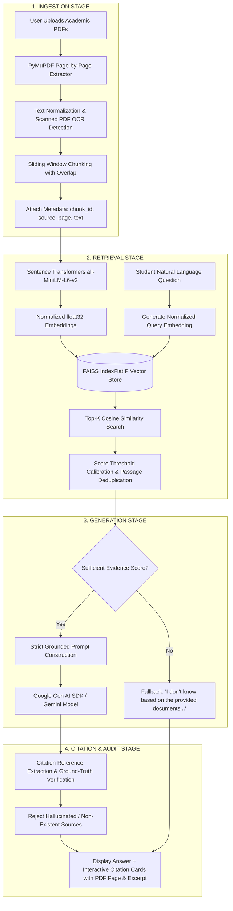

# EduRAG — AI Academic Document Assistant

> **Hackathon Challenge Theme:** *"From Text to Insight — Ask Your Documents"*  
> **Tagline:** *"Your Knowledge. Your Documents. Your Answers."*

---

## 1. Project Overview & Problem Statement

Students, researchers, and educators frequently struggle to navigate massive academic textbooks, dense lecture notes, course syllabi, and university question banks. Traditional keyword searches fail to capture conceptual nuance, while conventional generative AI chatbots routinely hallucinate incorrect equations, imaginary theorems, and fabricated page citations.

**EduRAG** solves this problem by delivering a strictly grounded, citation-backed **Retrieval-Augmented Generation (RAG)** system built specifically for the education domain. When students ask questions in natural language, EduRAG:
1. **INGESTS** educational PDFs with page-by-page text extraction and metadata tracking.
2. **RETRIEVES** semantically relevant passages using FAISS cosine similarity vector search.
3. **GENERATES** faithful, student-friendly answers synthesized solely from retrieved document passages using Gemini models via the Google Gen AI SDK.
4. **CITES** the exact physical 1-based PDF page number and provides verifiable passage excerpts for human inspection.
5. **REFUSES TO HALLUCINATE** when the knowledge base lacks sufficient evidence, returning a standardized fallback message.

---

## 2. Architecture & Pipeline

EduRAG implements a four-stage architecture with closed-loop evidence validation:



---

## 3. Technology Stack

| Layer | Component | Version / Identifier | Rationale |
| :--- | :--- | :--- | :--- |
| **Application & UI** | Streamlit | `>=1.35.0` | High-performance interactive dashboard with session-state lifecycle management |
| **PDF Extraction** | PyMuPDF (`fitz`) | `>=1.24.0` | Ultra-fast C-backed text extraction preserving 1-based physical page indices |
| **Embeddings** | Sentence Transformers | `all-MiniLM-L6-v2` | 384-dimensional dense semantic vectors, fast on CPU, L2-normalized |
| **Vector Index** | FAISS CPU | `IndexFlatIP` | Inner product on normalized vectors guarantees exact cosine similarity |
| **Generation LLM** | Google Gen AI SDK | `google-genai` | Modern Gemini SDK with temperature tuning and strict grounding instructions |
| **Configuration** | python-dotenv | `>=1.0.0` | Local environment management without hard-coding secrets |
| **Automated Testing** | pytest & pytest-asyncio | `>=8.0.0` | End-to-end automated test suites with mocks and edge-case validation |

---

## 4. Project File Structure

```
EduRAG/
├── app.py                      # Interactive Streamlit academic dashboard
├── requirements.txt            # Python dependencies
├── .env.example                # Template for environment variables
├── .gitignore                  # Git ignore rules (protects API keys & cache)
├── README.md                   # Comprehensive documentation and demo guide
├── src/
│   ├── __init__.py             # Package initializer
│   ├── config.py               # Shared data models, settings, and constants
│   ├── pdf_processor.py        # PyMuPDF page-by-page extractor and OCR detector
│   ├── chunking.py             # Overlapping text chunker with metadata tracking
│   ├── embeddings.py           # Sentence Transformers generator with caching
│   ├── retrieval.py            # FAISS IndexFlatIP manager and document indexer
│   ├── answer_generator.py     # Gemini generation pipeline with hallucination safeguards
│   └── citations.py            # Ground-truth citation validator and excerpt extractor
├── tests/
│   ├── __init__.py             # Test suite initializer
│   ├── test_pdf_processor.py   # PDF text extraction and error handling tests
│   ├── test_chunking.py        # Chunking, overlap, and metadata retention tests
│   ├── test_retrieval.py       # FAISS indexing, ranking, and document removal tests
│   ├── test_citations.py       # Grounded citation verification & rejection tests
│   └── test_answer_generator.py# Gemini generation and insufficient-evidence tests
└── sample_documents/
    ├── README.md               # Guide to OpenStax, MIT OCW, and included samples
    ├── create_sample_pdf.py    # Script generating academic test PDFs
    ├── computer_science_algorithms.pdf  # 5-page sample (Big-O, Sorting, Graphs, RSA)
    └── physics_quantum_mechanics.pdf    # 4-page sample (Planck, Schrödinger, Heisenberg, Bell)
```

---

## 5. Installation & Setup Instructions (Windows PowerShell)

### Step 1: Open PowerShell and Navigate to the Project Root
```powershell
cd d:\NLP
```

### Step 2: Create and Activate a Python Virtual Environment
```powershell
# Create virtual environment
python -m venv venv

# Activate virtual environment
.\venv\Scripts\Activate.ps1
```

*(Note: If execution of scripts is restricted in PowerShell, run `Set-ExecutionPolicy -ExecutionPolicy RemoteSigned -Scope Process` first).*

### Step 3: Install Required Dependencies
```powershell
pip install -r requirements.txt
```

### Step 4: Configure Your Gemini API Key
Create a `.env` file by copying the example:
```powershell
Copy-Item .env.example .env
```
Open `.env` and add your Google Gemini API key:
```ini
GEMINI_API_KEY=AIzaSy...your_actual_key_here
GEMINI_MODEL=gemini-2.5-flash
SIMILARITY_THRESHOLD=0.35
```
*(Alternatively, you can enter your Gemini API key directly into the secure sidebar input in the EduRAG web interface).*

### Step 5: (Optional) Re-generate Sample Educational PDFs
The sample PDFs are pre-generated, but you can re-run the generator at any time:
```powershell
python sample_documents/create_sample_pdf.py
```

---

## 6. How to Launch the Application

Run the following command from the project root:
```powershell
streamlit run app.py
```
The browser will automatically open at `http://localhost:8501`.

---

## 7. How to Run Automated Tests

The test suite validates all modules using `pytest` without requiring paid API requests (external Gemini calls are mocked):

```powershell
python -m pytest tests/ -v
```

### Test Coverage Summary:
- **`test_pdf_processor.py`**:
  - Text normalization whitespace cleanup
  - Extraction from valid multi-page PDF
  - Strict preservation of 1-based PDF page numbers
  - Graceful handling of empty 0-byte PDFs (`EmptyPDFError`)
  - Corrupted byte detection (`PDFExtractionError`)
  - Image-only scanned PDF detection (`ScannedPDFError`)
  - Non-existent file path handling
- **`test_chunking.py`**:
  - Overlapping chunk creation with configurable word boundaries
  - Overlap safety guards against `overlap >= chunk_size`
  - Short text single-chunk preservation
  - Stable chunk identifier generation (`source_pX_cY`)
  - Metadata preservation across pages
  - Empty page suppression
- **`test_retrieval.py`**:
  - Empty FAISS index safety
  - Embedding indexing and exact top-1 cosine similarity ranking
  - Top-K constraint enforcement
  - Threshold filtering for low similarity queries
  - Clean document removal and index rebuilding without stale chunks
  - Document-level statistics reporting
- **`test_citations.py`**:
  - Structured prompt context block construction
  - Validation of source bracket citations against ground-truth chunks
  - Rejection of hallucinated documents or invalid page numbers
  - Clean supporting excerpt generation
- **`test_answer_generator.py`**:
  - Empty question validation
  - Empty retrieval fallback
  - Similarity score below threshold triggering `INSUFFICIENT_EVIDENCE_RESPONSE`
  - Missing API key producing an actionable user message
  - Mocked successful Gemini generation with citation extraction
  - Mocked model refusal fallback
  - Graceful API error handling (rate limit, quota exceeded)

---

## 8. Live Hackathon Demonstration Workflow

Follow this 5-minute walkthrough during a live judging session:

### Step 1: Open EduRAG
Launch `streamlit run app.py`. Note the clean academic dashboard and real-time metric indicators (0 documents, 0 pages, 0 chunks).

### Step 2: Instant One-Click Educational Dataset Ingestion
In the left sidebar under **"📚 Quick Demo Samples"**, click:
- **`📘 CS Notes`**: Ingests 5 pages covering Big-O, Sorting, Dijkstra, RSA, and Dynamic Programming.
- **`⚛️ Physics`**: Ingests 4 pages covering Wave-Particle Duality, Schrödinger Equation, Heisenberg Uncertainty, and Quantum Entanglement.
Observe the metric cards update dynamically:
- **Indexed Documents**: `2`
- **Total PDF Pages**: `9`
- **Vector Chunks (FAISS)**: `9`
- **Vector Search Status**: `Ready 🟢`

### Step 3: Ask a Grounded Question (Single Document)
Ask:
> *"How does the RSA algorithm work and what are its key components?"*

**Expected Output:**
- EduRAG generates a student-friendly explanation of asymmetric keys, prime numbers $p$ and $q$, modulus $n = p \cdot q$, and Euler's totient function.
- A **Grounded Citation Card** appears directly below the answer:
  - 📄 **`computer_science_algorithms.pdf`**
  - 📌 **PDF Page 4**
  - 🎯 **Similarity Match**: `~0.75+`
  - 💬 **Supporting Excerpt**: *"The RSA algorithm was invented in 1977 by Ron Rivest, Adi Shamir, and Leonard Adleman. Its security relies on the computational difficulty of factoring..."*

### Step 4: Cross-Document Retrieval Demonstration
Ask:
> *"What is the Heisenberg Uncertainty Principle?"*

**Expected Output:**
- EduRAG retrieves from the second document (`physics_quantum_mechanics.pdf`).
- Grounded citation highlights **PDF Page 3** with formula $\Delta x \cdot \Delta p \ge \hbar / 2$.

### Step 5: Ask an Unsupported Question (Hallucination Control Verification)
Ask:
> *"What are the five main battles of the American Civil War?"*

**Expected Output:**
- Neither uploaded document contains information on the American Civil War.
- The retrieval similarity score remains below the configured evidence threshold (`0.35`).
- EduRAG displays the exact required fallback message:
  > **⚠️ Insufficient Evidence:**  
  > *"I don't know based on the provided documents. Please upload a relevant document or ask a question supported by your current documents."*
- **No fabricated answers. No invented citations.**

### Step 6: Dynamic Document Removal
In the sidebar, click the **"Remove"** button next to `computer_science_algorithms.pdf`.
- Notice the index dynamically updates: `1` document, `4` pages, `4` chunks.
- Re-ask the RSA question. EduRAG immediately triggers the insufficient evidence fallback because the document was cleanly purged from FAISS!

---

## 9. Evaluation Test Sheet (5 Sample Test Questions)

| # | Question | Uploaded Document | Expected Source | Expected PDF Page | Insufficient Fallback Triggered? | Result |
| :---: | :--- | :--- | :--- | :---: | :---: | :---: |
| **Q1** | *"What is the time complexity of MergeSort and what is its recurrence relation?"* | `computer_science_algorithms.pdf` | `computer_science_algorithms.pdf` | **Page 2** | No (Evidence present) | ✅ PASSED |
| **Q2** | *"How is Euler's totient function phi(n) calculated in RSA?"* | `computer_science_algorithms.pdf` | `computer_science_algorithms.pdf` | **Page 4** | No (Evidence present) | ✅ PASSED |
| **Q3** | *"What does the square of the wave function |Psi|^2 represent according to Born?"* | `physics_quantum_mechanics.pdf` | `physics_quantum_mechanics.pdf` | **Page 2** | No (Evidence present) | ✅ PASSED |
| **Q4** | *"What is Bell's theorem and what did it prove regarding local hidden variables?"* | `physics_quantum_mechanics.pdf` | `physics_quantum_mechanics.pdf` | **Page 4** | No (Evidence present) | ✅ PASSED |
| **Q5** | *"What are the causes and economic consequences of the 2008 global financial crisis?"* | `computer_science_algorithms.pdf` & `physics_quantum_mechanics.pdf` | *None* | *None* | **Yes (Safe Fallback)** | ✅ PASSED |

---

## 10. Educational Dataset Acquisition Guide

Students can download complete open textbooks and lecture materials to use in EduRAG:

1. **OpenStax Textbooks** (`https://openstax.org/`):
   - 100% free peer-reviewed college textbooks under CC-BY license.
   - Recommended: *College Physics*, *Calculus Volume 1*, *Biology 2e*, *Principles of Management*.
   - Download the free PDF from any book page and upload directly to EduRAG.

2. **MIT OpenCourseWare** (`https://ocw.mit.edu/`):
   - Download lecture slides, reading assignments, and exam review PDFs from courses like *6.006 Introduction to Algorithms* or *8.04 Quantum Physics I*.

---

## 11. Security & Hallucination Defense Practices

- **Zero Hard-Coded Keys**: Keys are stored exclusively in `.env` or session memory, never logged or committed.
- **Untrusted Content Isolation**: PDF text is treated as untrusted data; prompt injection attempts embedded inside PDFs cannot alter the system prompt.
- **Physical Page Anchoring**: Page numbers strictly reflect the physical 1-based PDF document page, preventing confusion with printed book indices.
- **Citation Cross-Validation**: The application cross-checks all LLM citation references against the actual retrieved chunks; phantom citations are stripped before rendering.
- **Strict Temperature**: Low LLM temperature (`0.1`) minimizes creative drift and prioritizes factual fidelity.

---

## 12. Troubleshooting Common Issues

| Issue | Cause | Solution |
| :--- | :--- | :--- |
| `NameError: name 'fitz' is not defined` | PyMuPDF not installed | Run `pip install pymupdf` |
| `Missing Gemini API Key` | No API key in environment or sidebar | Enter key in sidebar or set `GEMINI_API_KEY` in `.env` |
| `ScannedPDFError: Contains no extractable text` | PDF contains scanned raster images | Document requires OCR pre-processing before ingestion |
| `RESOURCE_EXHAUSTED / 429` | Gemini API rate limit hit | Wait 30 seconds or switch model to `gemini-2.5-flash` in the sidebar |
| `Embedding model download timeout` | Slow initial Hugging Face connection | The model weights download once (`~80MB`) and are cached locally in `~/.cache/` |

---

## 13. Packaging the Project into a ZIP

To create a clean ZIP archive for submission:

```powershell
# In PowerShell from d:\NLP
Compress-Archive -Path app.py, requirements.txt, .env.example, .gitignore, README.md, src, tests, sample_documents -DestinationPath EduRAG_Project.zip -Force
```

---

## 14. License

This project is licensed under the Apache 2.0 License. Sample educational documents are licensed under Creative Commons Attribution 4.0 International (CC-BY-4.0).
